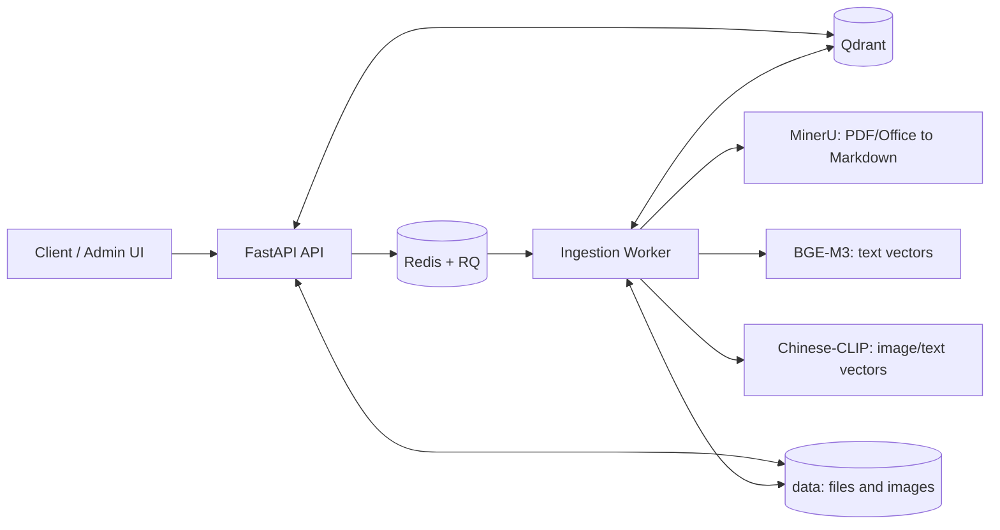

# AtlasRAG

> Multimodal knowledge-base retrieval service · **图谱智检**

[中文文档](README.zh-CN.md)

AtlasRAG ingests text, tables, PDF/Office documents, and images into a searchable internal knowledge base. It provides text search, text-to-image search, image-to-image search, document-to-Markdown conversion, and an administration UI.

> The current service has no authentication. Deploy it only on a controlled intranet; do not expose it directly to the public internet.

## What it solves

- Ingests `txt`, `md`, `csv`, `pdf`, `docx`, `pptx`, `xlsx`, and `jpg/jpeg/png` through one service.
- Splits long Markdown while preserving heading, table, and code-block boundaries.
- Combines semantic, lexical, and exact-term retrieval to improve recall for domain terminology.
- Indexes images embedded in documents and supports text-to-image and image-to-image search.
- Runs costly parsing, OCR, embedding, and directory imports as background work.
- Uses content hashes to skip unchanged files, replace stale versions, and clean up related data on deletion.

## Architecture



| Component | Responsibility |
| --- | --- |
| FastAPI (`app/api`) | HTTP API, job status, document/image resources, and query-model preloading. |
| Redis + RQ | Queue and job state for ingestion, deletion, and directory scanning. |
| Worker (`app/worker.py`) | Parsing, chunking, OCR, embedding, Qdrant writes, and directory watching. |
| Qdrant | `text_chunks` (text vectors) and `images` (CLIP vectors) collections. |
| MinerU | PDF/Office conversion to Markdown and embedded-image extraction. |
| Admin UI | Gradio UI that operates through the API. |

### Ingestion and retrieval

1. The API accepts a file upload or directory-index request and enqueues expensive work in Redis.
2. The worker hashes the file. Unchanged files are skipped; old records from the same path are removed when content changes.
3. Text, Markdown, and CSV parse directly; PDF/Office files use MinerU; standalone images use OCR and CLIP encoding.
4. Markdown chunks respect headings, tables, and code blocks. Other text uses character windows. Records are embedded and written to Qdrant.
5. Text search fuses multiple retrieval signals and can rerank candidates. Image and text-to-image search use CLIP similarity.

## Models and retrieval strategy

| Model/component | Default | Role |
| --- | --- | --- |
| BGE-M3 | `BAAI/bge-m3` | Creates 1024-dimensional dense vectors and sparse term weights for document chunks and text queries. Dense vectors capture semantic similarity; sparse vectors retain lexical signals. |
| Chinese-CLIP | `OFA-Sys/chinese-clip-vit-base-patch16` | Creates shared 512-dimensional vectors for images and text. Used for image indexing, image-to-image search, and text-to-image search. |
| BGE Reranker | `BAAI/bge-reranker-v2-m3` | Optional Cross-Encoder second stage. Reranks Qdrant candidates for better final text ranking; disabled by default in Compose to save resources. |
| MinerU | `pipeline` backend | Parses PDF/Office files to Markdown and extracts embedded images. It is a document parser, not a retrieval model. |
| PaddleOCR | Chinese (`ch`) | Reads standalone image text so that image content can enter the text index. Images themselves are indexed with CLIP. |

Text retrieval uses Reciprocal Rank Fusion (RRF) over: BGE-M3 dense semantic retrieval, BGE-M3 sparse keyword retrieval, and Qdrant full-text exact matching for terminology. With `RERANKER_ENABLED=true`, the service retrieves `RERANKER_CANDIDATE_K` candidates and reranks them before returning `top_k`. RRF scores are ranking signals, not absolute relevance scores comparable across requests.

## Deployment and processes

`docker-compose.yml` starts six service types:

| Service | Default process count | Host port | Notes |
| --- | ---: | --- | --- |
| `qdrant` | 1 Qdrant process | `6333` | Vector database; data persists in `data/qdrant`. |
| `redis` | 1 Redis process | not published | RQ queue and job state; data persists in `data/redis`. |
| `mineru` | 1 `mineru-api` process | `8100` | PDF/Office conversion service, configured for GPU. |
| `api` | **4 Uvicorn worker processes** | `18000` | Each process independently loads query models and serves HTTP. |
| `worker` | 1 RQ worker process | none | Consumes ingestion and deletion jobs; loads ingestion models. |
| `admin-ui` | 1 Gradio process | `27860` | Management UI; communicates only through the API. |

The default deployment includes four API Python processes, one ingestion worker, one MinerU process, Qdrant, Redis, and the UI. API workers mitigate single-process GIL contention, but each has its own BGE-M3 and Chinese-CLIP models (and its own reranker when enabled). Increasing `API_WORKERS` trades GPU/host memory for throughput.

API, Worker, and MinerU request GPU resources. They share `${HOME}/.cache/huggingface` at `/hf_cache` and run offline, so required model weights must be populated before startup.

## Quick start

Prerequisites: Docker Compose, NVIDIA Container Toolkit, and a prepared Hugging Face/MinerU model cache.

```bash
docker compose up -d --build
docker compose ps
curl http://localhost:18000/health
```

| Service | Address |
| --- | --- |
| API / OpenAPI | `http://localhost:18000` / `http://localhost:18000/docs` |
| Admin UI | `http://localhost:27860` |
| Qdrant | `http://localhost:6333` |
| MinerU | `http://localhost:8100` |

## Common APIs

| Method | Path | Description |
| --- | --- | --- |
| `POST` | `/documents/upload` | Upload and asynchronously ingest a document; returns `job_id`. |
| `POST` | `/directories/index` | Bulk-index a directory and optionally watch for changes. |
| `GET` | `/jobs/{job_id}` | Read job progress and file-level failures. |
| `POST` | `/search/text` | Search text and/or images with a text query. |
| `POST` | `/search/image` | Find similar images and related text for an uploaded image. |
| `POST` | `/documents/convert-to-markdown` | Convert a document without indexing it. |
| `GET` | `/documents` | List indexed documents. |
| `DELETE` | `/documents/{doc_id}` | Delete a document, vectors, and related images asynchronously. |

```bash
curl -F 'file=@./example.pdf' http://localhost:18000/documents/upload
curl http://localhost:18000/jobs/<job_id>

curl -X POST http://localhost:18000/search/text \
  -H 'Content-Type: application/json' \
  -d '{"query":"contract renewal terms", "top_k":5, "modalities":["text","image"]}'
```

Directory indexing is restricted to `ALLOWED_INDEX_ROOTS`; by default only paths under `DATA_DIR` are permitted. See the interactive API reference at `/docs` for all endpoints.

## Key configuration

See [`.env.example`](.env.example) for all settings.

| Setting | Default | Purpose |
| --- | --- | --- |
| `DATA_DIR` | `./data` | Uploads, thumbnails, extracted images, and local data. |
| `CHUNK_SIZE` / `CHUNK_OVERLAP` | `1000` / `150` | Text chunk window and overlap. |
| `RERANKER_ENABLED` | local `true`; Compose `false` | Enables Cross-Encoder reranking. |
| `RERANKER_CANDIDATE_K` | `10` | Candidate count before reranking. |
| `API_WORKERS` | Compose `4` | Number of API processes. |
| `ALLOWED_INDEX_ROOTS` | `[DATA_DIR]` | Allowlist for directory indexing. |
| `MINERU_TIMEOUT_SECONDS` | `600` | MinerU conversion timeout. |

## Operational status

| Concern | Status | Current handling and remaining boundary |
| --- | --- | --- |
| Unauthenticated file access | **Open — mitigated** | `ALLOWED_INDEX_ROOTS` constrains directory indexing, but the service still has no identity or access control. Add authentication, authorization, auditing, rate limits, and network isolation for production. |
| Slow long-document ingestion | **Partially mitigated** | RQ makes ingestion asynchronous; single-file jobs receive a one-hour timeout and directory jobs have no timeout. MinerU remains the main PDF/Office performance bottleneck, so monitor queue depth and capacity. |
| Stale search results after edits | **Fixed — regression-tested** | Content hashes skip identical files. Before writing a changed file, the worker removes every older `doc_id` for the same source path. Do not modify Qdrant outside the service. |
| Orphaned PDF-extracted images | **Fixed — regression-tested** | Parent-document deletion now cascades to prefixed image records and their original/thumbnail files; re-ingestion cleanup and watched-file deletion use the same path. Delete documents through the API. Existing orphans created before this fix require a one-off cleanup. |
| Model cold start / repeated downloads | **Fixed for readiness and cache reuse** | API readiness waits for models to load; containers share an offline HF cache, preventing repeat downloads. Required weights must still be provisioned before startup. |

Further analysis: [`docs/QA.md`](docs/QA.md), [`docs/concurrency-benchmark.md`](docs/concurrency-benchmark.md), [`docs/pdf-ingestion-performance.md`](docs/pdf-ingestion-performance.md), and [`docs/retrieval-relevance-filtering.md`](docs/retrieval-relevance-filtering.md).

## Repository layout

```text
app/        FastAPI API, ingestion, model wrappers, retrieval, storage, jobs, evaluation
admin_ui/   Gradio management UI
scripts/    environment checks, benchmarks, and evaluation scripts
tests/      unit and integration tests
docs/       design, performance, and incident documentation
```

## Data safety

- `data/`, `.env`, and virtual environments are ignored by Git. Do not commit business documents, indexes, or local credentials.
- Use a secret manager or controlled environment variables for production configuration.
