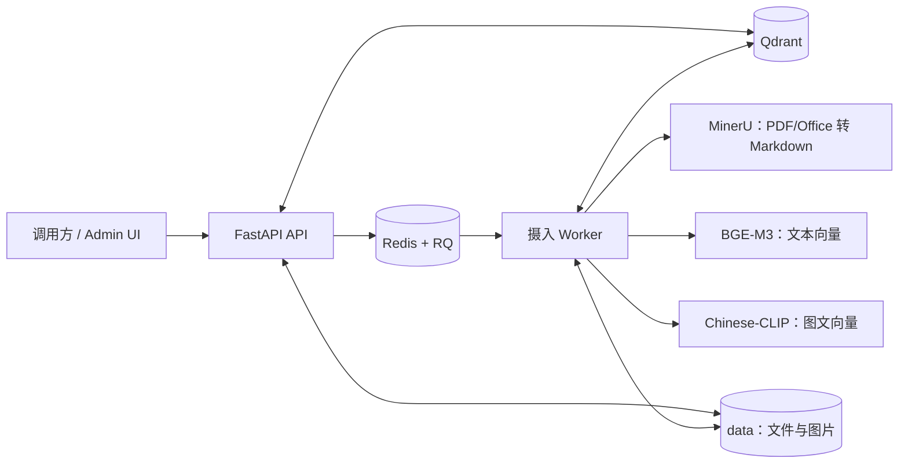

# AtlasRAG（图谱智检）

[English README](README.md)

AtlasRAG 是面向内部知识库的多模态文档摄入与检索服务。它将文本、表格、PDF/Office 文档和图片转为可检索的向量与元数据，支持文本检索、以文搜图、以图搜图、文档转 Markdown 和管理界面。

> 当前版本没有认证能力，只应部署在受控内网，不能直接暴露到公网。

## 解决的问题

- 通过一套服务统一摄入 `txt`、`md`、`csv`、`pdf`、`docx`、`pptx`、`xlsx` 与 `jpg/jpeg/png`。
- 按标题、表格和代码块边界切分 Markdown，避免长文档破坏结构与上下文。
- 结合语义、关键词和精确术语检索，改善专业名词和罕见实体的召回。
- 提取并索引文档中的图片，支持文字找图片和相似图片检索。
- 将解析、OCR、向量化、目录批量导入放到后台，避免阻塞 API。
- 利用内容哈希跳过未变文件，替换旧版本，并在删除时级联清理关联数据。

## 架构



| 组件 | 职责 |
| --- | --- |
| FastAPI（`app/api`） | HTTP API、任务状态、文档/图片资源，并在启动时加载查询模型。 |
| Redis + RQ | 摄入、删除、目录扫描任务及状态。 |
| Worker（`app/worker.py`） | 解析、切分、OCR、向量化、Qdrant 写入和目录监听。 |
| Qdrant | `text_chunks` 文本向量集合和 `images` CLIP 图片向量集合。 |
| MinerU | PDF/Office 转 Markdown，并提取其中的图片。 |
| Admin UI | 基于 Gradio 的管理界面，通过 API 操作服务。 |

### 摄入与检索流程

1. API 接收上传或目录索引请求，并把耗时工作投递给 Redis 队列。
2. Worker 计算内容哈希：未变化文件跳过；同一路径新版本会清理旧记录。
3. 文本、Markdown、CSV 直接解析；PDF/Office 使用 MinerU；独立图片使用 OCR 和 CLIP。
4. Markdown 依据标题、表格、代码块边界切分；其他文本按字符窗口切分，然后写入 Qdrant。
5. 文本检索融合多路召回且可二阶段重排；图像和文字搜图使用 CLIP 相似度。

## 模型与检索策略

| 模型/组件 | 默认配置 | 作用 |
| --- | --- | --- |
| BGE-M3 | `BAAI/bge-m3` | 为文档分片和文本查询生成 1024 维 dense 向量及 sparse 词项权重。dense 负责语义相似，sparse 保留关键词信号。 |
| Chinese-CLIP | `OFA-Sys/chinese-clip-vit-base-patch16` | 为文本和图片生成共同的 512 维向量空间；用于图片索引、以图搜图和以文搜图。 |
| BGE Reranker | `BAAI/bge-reranker-v2-m3` | 可选 Cross-Encoder 二阶段模型，对 Qdrant 召回候选重排以提升最终文本排序质量；Compose 默认关闭以节省资源。 |
| MinerU | `pipeline` backend | 将 PDF/Office 转换为 Markdown 并提取内嵌图片；它是文档解析组件，不是检索模型。 |
| PaddleOCR | 中文（`ch`） | 识别独立图片中的文字，使图片内容可进入文本索引；图片本身仍由 CLIP 建立向量。 |

文本检索使用 Reciprocal Rank Fusion（RRF）融合三路候选：BGE-M3 dense 语义检索、BGE-M3 sparse 关键词检索，以及 Qdrant 全文精确匹配（术语兜底）。当 `RERANKER_ENABLED=true` 时，先取 `RERANKER_CANDIDATE_K` 个候选，再重排并返回 `top_k`。RRF 分数是排序信号，不是能跨请求比较的绝对相关性分数。

## 部署与进程拓扑

`docker-compose.yml` 默认启动六类服务：

| 服务 | 默认进程数 | 宿主机端口 | 说明 |
| --- | ---: | --- | --- |
| `qdrant` | 1 个 Qdrant 进程 | `6333` | 向量数据库，数据持久化到 `data/qdrant`。 |
| `redis` | 1 个 Redis 进程 | 不对宿主机开放 | RQ 队列和任务状态，数据持久化到 `data/redis`。 |
| `mineru` | 1 个 `mineru-api` 进程 | `8100` | PDF/Office 转换服务，配置为使用 GPU。 |
| `api` | **4 个 Uvicorn worker 进程** | `18000` | 各进程独立加载查询模型、处理 HTTP 请求。 |
| `worker` | 1 个 RQ worker 进程 | 无 | 消费摄入/删除任务，并加载摄入所需模型。 |
| `admin-ui` | 1 个 Gradio 进程 | `27860` | 管理界面，只经由 API 访问数据。 |

默认部署包含 4 个 API Python 进程、1 个摄入 Worker、1 个 MinerU 进程，以及 Qdrant、Redis 和 UI。API 多进程可缓解单进程 GIL 对并发检索的限制；但每个 API worker 都独立持有 BGE-M3、Chinese-CLIP，启用 rerank 后还会持有 reranker。因此增大 `API_WORKERS` 是用 GPU/主机内存换取吞吐，应按显存容量和压测结果调整。

API、Worker 与 MinerU 都申请 GPU 资源，且共享宿主机 `${HOME}/.cache/huggingface` 到容器内 `/hf_cache`。服务启用离线模式，部署前必须预先准备所需模型权重。

## 快速开始

前置条件：Docker Compose、NVIDIA Container Toolkit，以及已准备好的 Hugging Face/MinerU 模型缓存。

```bash
docker compose up -d --build
docker compose ps
curl http://localhost:18000/health
```

| 服务 | 地址 |
| --- | --- |
| API / OpenAPI | `http://localhost:18000` / `http://localhost:18000/docs` |
| Admin UI | `http://localhost:27860` |
| Qdrant | `http://localhost:6333` |
| MinerU | `http://localhost:8100` |

## 常用 API

| 方法 | 路径 | 说明 |
| --- | --- | --- |
| `POST` | `/documents/upload` | 上传并异步入库，返回 `job_id`。 |
| `POST` | `/directories/index` | 批量导入目录，可选监听后续变更。 |
| `GET` | `/jobs/{job_id}` | 查询任务进度和文件失败信息。 |
| `POST` | `/search/text` | 使用文本查询检索文本和/或图片。 |
| `POST` | `/search/image` | 上传查询图片，返回相似图片和关联文本。 |
| `POST` | `/documents/convert-to-markdown` | 只转换文档，不写入向量库。 |
| `GET` | `/documents` | 列出已入库文档。 |
| `DELETE` | `/documents/{doc_id}` | 异步删除文档、向量与关联图片。 |

```bash
curl -F 'file=@./example.pdf' http://localhost:18000/documents/upload
curl http://localhost:18000/jobs/<job_id>

curl -X POST http://localhost:18000/search/text \
  -H 'Content-Type: application/json' \
  -d '{"query":"合同续签条件", "top_k":5, "modalities":["text","image"]}'
```

目录索引受 `ALLOWED_INDEX_ROOTS` 约束；未设置时，只允许 `DATA_DIR` 下的目录。完整交互式接口见启动后的 `/docs`。

## 关键配置

所有配置见 [`.env.example`](.env.example)。

| 配置 | 默认值 | 作用 |
| --- | --- | --- |
| `DATA_DIR` | `./data` | 上传文件、缩略图、提取图片和本地数据。 |
| `CHUNK_SIZE` / `CHUNK_OVERLAP` | `1000` / `150` | 文本分片窗口和重叠长度。 |
| `RERANKER_ENABLED` | 本地 `true`；Compose `false` | 是否启用 Cross-Encoder 重排。 |
| `RERANKER_CANDIDATE_K` | `10` | 重排前的候选数量。 |
| `API_WORKERS` | Compose `4` | API 进程数。 |
| `ALLOWED_INDEX_ROOTS` | `[DATA_DIR]` | 允许目录索引读取的根目录白名单。 |
| `MINERU_TIMEOUT_SECONDS` | `600` | MinerU 转换超时。 |

## 重要运行事项状态

| 问题 | 状态 | 当前处理与剩余边界 |
| --- | --- | --- |
| 无鉴权的文件访问面 | **未解决，仅缓解** | `ALLOWED_INDEX_ROOTS` 限制目录索引范围，但服务仍没有身份认证或授权控制。生产环境必须补充认证、授权、审计、限流和网络隔离。 |
| 长文档摄入慢或失败 | **部分缓解** | RQ 异步执行；单文件任务超时为一小时，目录任务不设超时。MinerU 仍是 PDF/Office 的主要性能瓶颈，应监控队列积压与容量。 |
| 文件更新后出现旧结果 | **已修复，已有回归测试** | 内容哈希跳过相同文件；写入新版本前会删除同一 `source_path` 下所有旧 `doc_id`。不要绕过服务直接修改 Qdrant。 |
| PDF 内嵌图片变为孤儿数据 | **已修复，已有回归测试** | 删除父文档会级联清理带前缀的图片记录、原图和缩略图；重新入库清理和目录监听删除也复用该逻辑。修复前已产生的孤儿数据需单独做一次清理。 |
| 模型冷启动或重复下载 | **就绪检查与缓存复用已修复** | API 仅在模型加载完成后就绪；容器共享离线 HF 缓存，避免重复下载。模型权重仍必须在部署前准备好。 |

更多分析见 [`docs/QA.md`](docs/QA.md)、[`docs/concurrency-benchmark.md`](docs/concurrency-benchmark.md)、[`docs/pdf-ingestion-performance.md`](docs/pdf-ingestion-performance.md) 与 [`docs/retrieval-relevance-filtering.md`](docs/retrieval-relevance-filtering.md)。

分片质量、量化指标、运行命令及推荐的 A/B 评估流程见 [`docs/chunk-quality-evaluation.zh-CN.md`](docs/chunk-quality-evaluation.zh-CN.md)。英文版见 [`docs/chunk-quality-evaluation.md`](docs/chunk-quality-evaluation.md)。

## 项目结构

```text
app/        FastAPI API、摄入、模型封装、检索、存储、任务、评估
admin_ui/   Gradio 管理界面
scripts/    环境检查、压测和评估脚本
tests/      单元与集成测试
docs/       设计、性能和问题复盘文档
```

## 数据安全

- `data/`、`.env` 和虚拟环境已被 Git 忽略，不应提交业务文档、索引或本地凭证。
- 生产环境应使用密钥管理服务或受控环境变量注入配置。
